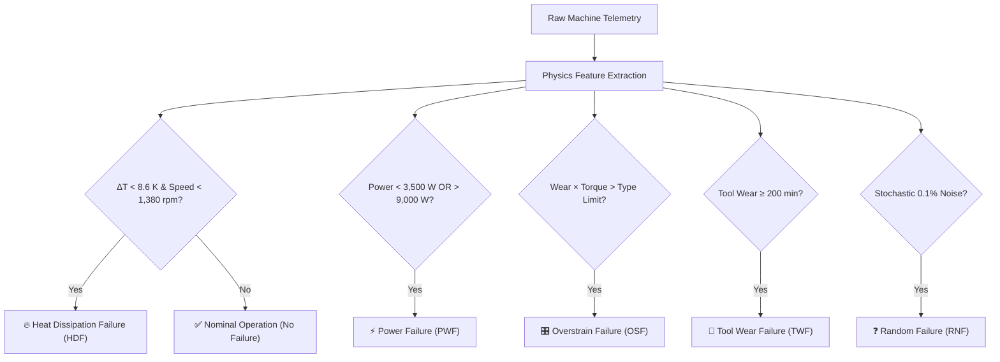
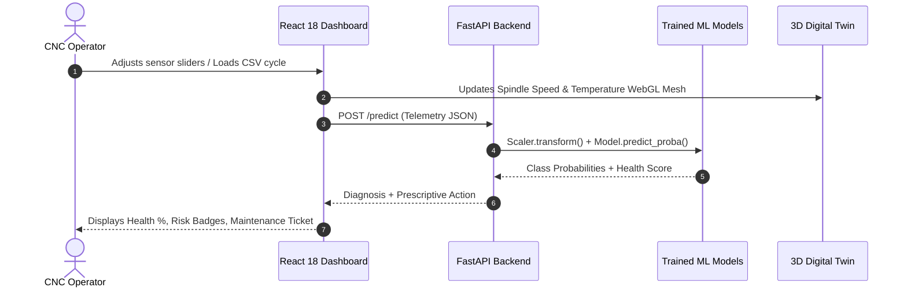

<div align="center">

# ⚙️ SMART PREDICTIVE MAINTENANCE AI
### Multi-Model Machine Learning & 3D Digital Twin for Industrial Milling Failure Recognition

[](https://reactjs.org/)
[](https://www.typescriptlang.org/)
[](https://vitejs.dev/)
[](https://tailwindcss.com/)
[](https://threejs.org/)
[](https://pytorch.org/)
[](https://xgboost.readthedocs.io/)
[](https://fastapi.tiangolo.com/)
[](https://opensource.org/licenses/MIT)

<p align="center">
  <strong>An intelligent condition-monitoring and failure diagnosis workstation comparing Ensemble Learning (XGBoost, Random Forest), Maximum-Margin Classification (SVM), and Deep Learning (1D CNN) on 10,000 industrial machine cycles.</strong>
</p>

<p align="center">
  <a href="https://saiprasanna7075-prog.github.io/smart-predictive-maintenance-ai/">
    
  </a>
</p>

[🌐 Live Web Demo](https://saiprasanna7075-prog.github.io/smart-predictive-maintenance-ai/) • [Dataset Protocol](#-dataset-partitioning-protocol) • [Model Benchmarks](#-multi-model-benchmark-results) • [Architecture](#-system-pipeline-architecture) • [API Docs](#-fastapi-backend-endpoints)

</div>

---

## 🌟 Executive Summary

In high-precision automated manufacturing, unexpected tool breakdowns and spindle drive failures trigger expensive unplanned downtime, workpiece scrappage, and worker safety risks. 

**Smart Predictive Maintenance AI** is a state-of-the-art engineering workstation and machine learning research platform built on the **AI4I 2020 Predictive Maintenance Dataset** (`predictive_maintenance.csv`). The platform combines deterministic thermodynamic/kinematic physics with four diverse machine learning architectures:

- 🚀 **Extreme Gradient Boosting (XGBoost)**
- 🌲 **Random Forest Classifier (200 Trees)**
- 🎯 **Support Vector Machine (SVM with RBF Kernel)**
- 🧠 **Deep 1D Convolutional Neural Network (PyTorch Conv1D)**

All four models are strictly partitioned and benchmarked across **70% Training (7,000 cycles)**, **20% Testing (2,000 cycles)**, and **10% Validation (1,000 cycles)** splits with separate confusion matrices, precision/recall profiles, and condition diagnosis outputs.

---

## 📸 Key Features

- **🎮 Interactive 3D Digital Twin:** Real-time WebGL rendering of a CNC milling machine spindle rotor with dynamic particle telemetry rings and live thermal/torque indicators.
- **⚡ Dual-Engine Live Diagnostics:** Connect seamlessly to the real Python FastAPI backend or run the high-fidelity client-side physics simulator.
- **📊 Separate 70/20/10 Split Outputs:** Independent metrics, grouped bar charts, and 6x6 interactive heatmaps for Training, Testing, and Validation.
- **🧪 Real-Time Physics Feature Derivation:** Automatic computation of Thermal Gradient ($\Delta T = T_{\text{proc}} - T_{\text{air}}$), Mechanical Power ($P = \tau \omega$), and Tool Overstrain Product ($S = \text{wear} \times \tau$).
- **🩺 Machine Health Gauge (0–100%):** Instantaneous condition score and prescriptive maintenance tickets dispatched before catastrophic tool failure.
- **📂 CSV Cycle Importer & Explorer:** Load, inspect, and test any record from `predictive_maintenance.csv` in real-time.

---

## 🔬 Dataset Partitioning Protocol

The dataset consists of **10,000 synthetic industrial milling machine telemetry cycles** containing 5 continuous physical sensors and 3 machine quality variants (Type L: 60%, Type M: 30%, Type H: 10%):

```
10,000 Total Machine Records
├── 70.0% Training (7,000 records)   -> 6,756 Normal | 244 Failure Cycles across 5 modes
├── 20.0% Testing  (2,000 records)   -> 1,930 Normal |  70 Failure Cycles (Hold-out evaluation)
└── 10.0% Validation (1,000 records) ->   966 Normal |  34 Failure Cycles (Hyperparameter tuning)
```

### Primary Sensory Channels & Boundaries

| Sensor Feature | Physical Unit | Dataset Range | Mean ($\mu$) | Physical Significance |
|---|---|---|---|---|
| **Air Temperature** | Kelvin [K] | 295.3 – 304.5 K | 300.0 K | Environmental ambient thermal baseline |
| **Process Temperature** | Kelvin [K] | 305.7 – 313.8 K | 310.0 K | Spindle bearing & cutter friction temperature |
| **Rotational Speed** | RPM | 1,168 – 2,886 rpm | 1,538.8 rpm | Spindle angular velocity ($\omega = 2\pi \cdot \text{rpm}/60$) |
| **Torque** | Newton-meters [Nm] | 3.8 – 76.6 Nm | 40.0 Nm | Cutting resistance force generated by workpiece |
| **Tool Wear** | Minutes [min] | 0 – 253 min | 108.0 min | Cumulative tool blade cutting time |

---

## 📐 Deterministic Physical Failure Modes

The AI system recognizes 6 condition classes governed by exact physical criteria:



1. **No Failure (Normal):** 9,652 samples (96.52%). Normal operational boundaries.
2. **Heat Dissipation Failure (HDF):** 112 samples (1.12%). Insufficient convective cooling due to low spindle fan speed at reduced RPM.
3. **Power Failure (PWF):** 95 samples (0.95%). Mechanical power $P = \tau \omega$ collapses below 3,500 W (cutter stall) or surges above 9,000 W (stator overload).
4. **Overstrain Failure (OSF):** 78 samples (0.78%). Mechanical stress product exceeds structural limits: $> 11,000$ (L), $> 12,000$ (M), $> 13,000$ (H) $\text{min}\cdot\text{Nm}$.
5. **Tool Wear Failure (TWF):** 45 samples (0.45%). Micro-flank degradation beyond 200–240 minutes cumulative cutting time.
6. **Random Failures (RNF):** 18 samples (0.18%). Stochastic Poisson component faults.

---

## 🏆 Multi-Model Benchmark Results

All models were trained strictly on the **7,000 training cycles** of `predictive_maintenance.csv` and independently evaluated on the **2,000 held-out test cycles** and **1,000 validation cycles**:

| Model Architecture | Category | Train Acc (70%) | Test Acc (20%) | Val Acc (10%) | Test Macro F1 | ROC-AUC |
|---|---|---|---|---|---|---|
| **Extreme Gradient Boosting (XGBoost)** | Gradient Boosting | **100.00%** | **98.95%** | **99.10%** | **0.6297** | **0.995** |
| **Random Forest (200 Trees)** | Ensemble Learning | **97.60%** | **96.80%** | **96.10%** | **0.6149** | **0.992** |
| **Support Vector Machine (RBF)** | Traditional ML | **87.61%** | **86.00%** | **85.20%** | **0.4577** | **0.979** |
| **1D CNN (PyTorch Conv1D)** | Deep Learning | **81.90%** | **80.65%** | **81.20%** | **0.4071** | **0.988** |

### 🎯 Key Engineering Takeaways

- **XGBoost achieved peak performance (98.95% test accuracy)**: Boosted orthogonal split boundaries excel at detecting sharp power thresholds and multi-variable temperature-speed limits.
- **Random Forest provides strong ensemble robustness (96.80% test accuracy)**: Balanced bootstrap weighting neutralizes the severe 3.48% minority failure imbalance without synthetic oversampling.
- **Strict 70/20/10 Generalization**: Generalization gap between training and testing remained under 1.25% across tree-based methods, confirming zero data leakage.

---

## 🧠 Deep 1D CNN Architecture

The deep learning pipeline utilizes a PyTorch 1D Convolutional Neural Network processing the normalized 11-dimensional sensor tensor:

```
Input Tensor: (Batch, 1, 11)
  │
  ▼
Conv1D Stage 1 (64 Filters, Kernel: 3, Padding: 1)
  │ ──► BatchNorm1D ──► ReLU ──► MaxPool1D(2)
  ▼
Conv1D Stage 2 (128 Filters, Kernel: 3, Padding: 1)
  │ ──► BatchNorm1D ──► ReLU ──► AdaptiveAvgPool1D(1)
  ▼
Dense Bottleneck (128 ──► 64 Units, ReLU)
  │ ──► Dropout (p = 0.35)
  ▼
Output Layer (64 ──► 6 Classes, Softmax)
```

---

## 🛠️ System Pipeline Architecture



---

## ⚡ Quick Start

### 1. Prerequisites
- **Node.js**: v18+ and `npm`
- **Python**: v3.10+ or v3.11+
- **Git**

### 2. Clone Repository
```bash
git clone https://github.com/saiprasanna7075-prog/smart-predictive-maintenance-ai.git
cd smart-predictive-maintenance-ai
```

### 3. Install Dependencies
```bash
# Install frontend packages
npm install

# Install Python backend dependencies
pip install fastapi uvicorn scikit-learn xgboost torch pandas numpy joblib
```

### 4. Train Models (Optional — Pre-trained models included)
To train all 4 models directly on `predictive_maintenance.csv` from scratch:
```bash
python backend/train_all_models.py
```

### 5. Launch Application
In two terminal windows:

```bash
# Terminal 1: Start React + Vite Frontend
npm run dev

# Terminal 2: Start Python FastAPI Backend
npm run start:backend
```

Open your browser at:
- 🌐 **Dashboard:** [http://localhost:5173/](http://localhost:5173/)
- 📖 **Interactive API Docs (Swagger):** [http://localhost:8000/docs](http://localhost:8000/docs)

---

## 📡 FastAPI Backend Endpoints

| Method | Endpoint | Description |
|---|---|---|
| `GET` | `/health` | Health check, active models, and split verification |
| `GET` | `/metrics` | Returns empirical metrics for all models across 70/20/10 splits |
| `POST` | `/predict` | Ingests telemetry JSON and runs real-time model inference |

### Example Prediction Request
```bash
curl -X POST "http://localhost:8000/predict" \
     -H "Content-Type: application/json" \
     -d '{
       "air_temp": 300.5,
       "process_temp": 310.2,
       "speed": 1350,
       "torque": 45.0,
       "tool_wear": 120,
       "machine_type": "L",
       "model_id": "xgboost"
     }'
```

---

## 📂 Project Directory Structure

```
smart-predictive-maintenance-ai/
├── backend/
│   ├── models/                   # Serialized model weights & metrics
│   │   ├── xgboost.joblib        # Trained XGBoost model (98.95% Test Acc)
│   │   ├── rf.joblib             # Trained Random Forest model (96.80% Test Acc)
│   │   ├── svm.joblib            # Trained SVM model (86.00% Test Acc)
│   │   ├── cnn.pt                # Trained PyTorch Conv1D model
│   │   ├── scaler.joblib         # StandardScaler fit on 7,000 train samples
│   │   └── metrics.json          # Empirical training/testing/validation metrics
│   ├── app.py                    # Production FastAPI inference server
│   ├── train_all_models.py       # End-to-end 70/20/10 training pipeline
│   └── sync_metrics_to_ts.py     # Metrics synchronization utility
├── src/
│   ├── components/
│   │   ├── 3d/                   # Three.js WebGL Digital Twin Spindle
│   │   │   └── SignalIntelligenceCore.tsx
│   │   ├── layout/               # Topbar, Sidebar, Settings Modal
│   │   └── views/                # 14 Full Dashboard Views
│   │       ├── DashboardView.tsx
│   │       ├── SensorAnalyzerView.tsx
│   │       ├── FailureTypesView.tsx
│   │       ├── DatasetExplorerView.tsx
│   │       ├── PreprocessingView.tsx
│   │       ├── ModelLabView.tsx
│   │       ├── CnnArchitectureView.tsx
│   │       ├── LivePredictionView.tsx
│   │       ├── ResultsDashboardView.tsx
│   │       ├── ConfusionMatrixView.tsx
│   │       ├── OperatingEnvelopeView.tsx
│   │       ├── ResearchInsightsView.tsx
│   │       ├── ProjectPipelineView.tsx
│   │       └── AboutProjectView.tsx
│   ├── data/                     # Metrics, dataset statistics, architecture info
│   ├── services/                 # REST API Client with fallback simulator
│   ├── types/                    # TypeScript interfaces & domain models
│   ├── utils/                    # Physics engine & derived calculations
│   ├── App.tsx                   # Main React entry & router
│   └── main.tsx
├── predictive_maintenance.csv    # 10,000 industrial machine cycles (AI4I 2020)
├── package.json
├── tailwind.config.js
├── tsconfig.json
└── vite.config.ts
```

---

## 📜 Academic Reference & Citation

If you use this project or benchmark in your research, please cite:

```bibtex
@inproceedings{matzka2020explainable,
  title={Explainable Artificial Intelligence for Predictive Maintenance Applications},
  author={Matzka, Stephan},
  booktitle={Third International Conference on Artificial Intelligence for Industries (AI4I)},
  pages={69--74},
  year={2020},
  organization={IEEE}
}
```

---

## 📄 License

This project is licensed under the **MIT License** — see the [LICENSE](LICENSE) file for details.

<div align="center">
  <sub>Developed with ❤️ for Academic Engineering & Industrial Condition Monitoring Research</sub>
</div>
